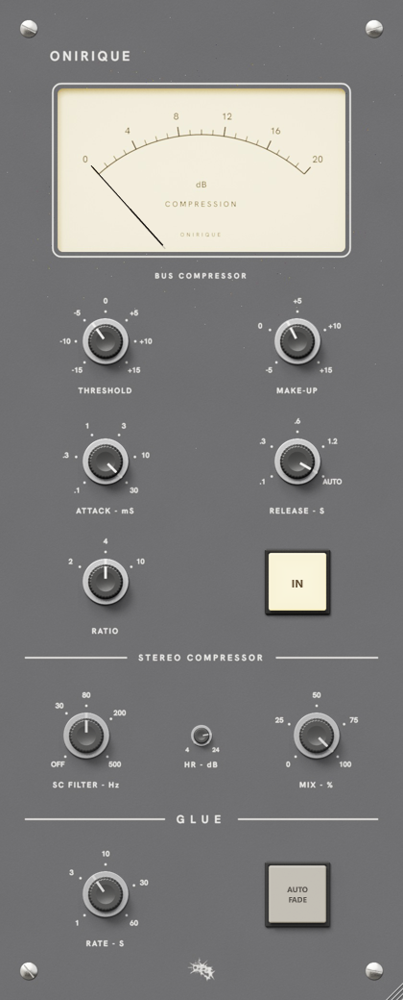

# Onirique Glue

Un compresseur de bus stéréo dans l'esprit du compresseur de la section centrale
des consoles G des années 80 : la même façade, les mêmes réglages aux mêmes
places, et la même façon de « coller » un mix. Propre au niveau normal, un peu
crémeux quand on le pousse.

- **un seul VCA pour les deux côtés**, et un détecteur qui écoute leur somme,
  comme sur la console : l'image stéréo ne bouge pas ;
- **des temps à crans** : attaque 0,1 / 0,3 / 1 / 3 / 10 / 30 ms, relâche
  0,1 / 0,3 / 0,6 / 1,2 s et **AUTO**, qui relâche vite après un coup isolé et
  lentement quand la compression dure ; c'est ce réglage qui colle ;
- **ratios 2, 4 et 10**, au genou plus doux à 2:1 et plus franc à 10:1 ;
- **filtre de side-chain** (OFF à 500 Hz) : la basse ne fait plus pomper ;
- **HR (headroom)** : la marge de l'étage de sortie ; haut, c'est propre, plus
  bas les crêtes s'arrondissent (harmoniques 2 et 3 mêlées) ;
- **MIX** pour la compression parallèle, et l'**AUTO FADE** de la console, sur
  1 à 60 secondes.

La façade est une photographie : la façade, le VU et chaque pièce sont modélisés
en 3D et rendus par lancer de rayons (`tools/photo.cpp`). Le plugin ne fait
qu'afficher ces images (`Resources/photo`) et dessine l'aiguille du VU par-dessus.

VST3 (Windows, macOS) et Audio Unit (macOS). Mono ou stéréo. Traitement à
fréquence doublée : la latence est annoncée à l'hôte.



---

## Les réglages

| Réglage | Ce qu'il fait |
|---|---|
| Threshold | -15 à +15 dB ; 0 correspond à -14 dBFS |
| Make-Up | -5 à +15 dB |
| Attack | 0,1 à 30 ms, six crans |
| Release | 0,1 à 1,2 s, ou AUTO |
| Ratio | 2, 4 ou 10 pour 1 |
| IN | éteint, le signal tel qu'il est entré, au bit près |
| SC Filter | passe-haut 12 dB/oct sur ce que le compresseur entend, OFF à 500 Hz |
| HR | 4 à 24 dB de marge avant que l'étage de sortie n'arrondisse ; 20 par défaut |
| Mix | 0 à 100 % de son compressé |
| Rate / Auto Fade | appuyé, le son descend au silence en Rate secondes ; relâché, il remonte |

Mesures (`test_glue`) : à -18 dBFS sans compression, H2 et H3 sous -68 dB ; à
-4 dBFS, H3 vers -42 dB et H2 vers -55 dB ; avec HR à 4, H3 monte vers -15 dB.

Survoler ou tourner un réglage affiche sa valeur juste à côté ; un double-clic
le remet par défaut.

---

## État du projet

| Partie | État |
|---|---|
| Moteur (courbe, temps, auto release, side-chain, couleur, fade) | fait, testé hors ligne (`test_glue`) |
| Plugin complet (fréquence doublée, latence, bypass) | testé hors ligne (`glue_snapshot --selftest`) |
| Interface | vérifiée sur capture (`glue_snapshot`) |
| Licence ONIRIQUE (`onirique-glue`) | intégrée ; aucun produit de ce nom au catalogue pour l'instant |
| Écoute dans un DAW | **pas encore faite** |

Les temps et le genou ont été placés par raisonnement à partir de ce qu'on sait
de l'original, pas mesurés sur un appareil ; la dose de couleur reste à régler à
l'oreille.

---

## Construire

JUCE 9.0.3 est cherché dans `JUCE/`, puis dans `../PitchBox/JUCE`.

```bash
cmake -B build -A x64
cmake --build build --config Release --parallel
ctest --test-dir build -C Release --output-on-failure
```

Le plugin sort dans `build/OniriqueGlue_artefacts/Release/VST3/OniriqueGlue.vst3`.

Les photographies de la façade, après un changement de modèle, de lumière ou de
disposition (`Source/ui/Layout.h`, partagé avec l'interface) ; `0.1` au lieu de
`1.3` pour un aperçu rapide :

```bash
cmake --build build --config Release --target glue_photo
build/glue_photo_artefacts/Release/glue_photo Resources/photo 1.3
build/glue_photo_artefacts/Release/glue_photo apercu 0.1 front,knob,trim,button,preview
```

Une capture de l'interface, sans hôte :

```bash
cmake --build build --config Release --target glue_snapshot
build/Release/glue_snapshot capture.png 1.5
```

Sur GitHub, chaque push construit Windows et macOS ; les plugins sont déposés sur
les branches `ci-build-Windows` et `ci-build-macOS`, les journaux sur `ci-logs-*`.

`License/` est copié tel quel de `plugin-license/` du dépôt ONIRIQUE CENTRAL, et
`Source/ui/OniriqueWindowSize.h` de `plugin-ui/` : ils ne se modifient que là-bas.
